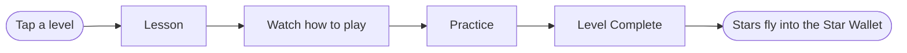

<a id="top"></a>

<div align="center">

# ⭐ TALA

### A Voice-Guided Learning App for Grade 1 Learners

*A fully offline, voice-first Android app that helps Filipino Grade 1 pupils (ages 6-7) learn phonics, numbers, shapes and colors, and good values through talking characters, mini-games, and star rewards.*

<br>


<br>

[Features](#-features) •
[Story](#-story-and-characters) •
[Getting Started](#-getting-started) •
[Contributing](#-contributing) •
[Docs](#-documentation)

</div>

<br>

<details>
<summary><b>📑 Table of Contents</b></summary>

1. [About the Project](#-about-the-project)
2. [Features](#-features)
3. [Story and Characters](#-story-and-characters)
4. [Modules](#-modules)
5. [How a Level Works](#-how-a-level-works)
6. [Project Status](#-project-status)
7. [Tech Stack](#-tech-stack)
8. [Project Structure](#-project-structure)
9. [Data Model](#-data-model)
10. [Getting Started](#-getting-started)
11. [Contributing](#-contributing)
12. [Working with the AI Coding Agent](#-working-with-the-ai-coding-agent)
13. [Build, Run, and Test](#-build-run-and-test)
14. [Troubleshooting](#-troubleshooting)
15. [Design and Accessibility](#-design-and-accessibility)
16. [Privacy and Safety](#-privacy-and-safety)
17. [Documentation](#-documentation)
18. [Screenshots](#-screenshots)
19. [Team and License](#-team-and-license)

</details>

---

## 🎯 About the Project

Many Grade 1 pupils have short attention spans with paper worksheets, cannot yet read instructions on their own, and need an adult to read every prompt aloud. **TALA** answers that with a gamified, audio-visual, self-paced learning app. It is a Computer-Aided Instruction (CAI) system built for a school project.

**Our goals**

- 🔊 Teach with **full voice-over**, so a pupil never needs to read to use the app
- 🎨 Keep learners engaged with **animation, audio cues, and mini-games**
- ✍️ Practice phonics with **finger tracing** and drag-and-drop exercises
- 📊 **Automatically track** and evaluate every pupil's performance
- 🧑‍🏫 Give teachers and parents **PIN-protected dashboards** with one-tap PDF reports

**Who uses it**

| User | What they do |
|------|--------------|
| 🧒 **Pupil** (primary) | Learns through lessons, mini-games, quizzes, and star rewards |
| 👩‍🏫 **Teacher / Parent** | Views progress analytics, adjusts difficulty, exports reports |
| 🛠️ **Administrator** | Manages accounts, content, backups, and maintenance inside the dashboard |

<p align="right">(<a href="#top">back to top</a>)</p>

---

## ✨ Features

### For pupils

- 🗣️ Voice narration in **English and Filipino**, with a distinct voice for each character
- 🌟 Talking guide characters with five states: waving, talking, thinking, cheering, sleepy
- 🗺️ A **level path** across five worlds, with a constellation of Star Pieces to light up
- ✍️ Finger tracing for all 26 letters, drag-and-drop counting and sorting, color mixing, and free painting
- 📖 Storybooks and choice scenarios for good values
- ❓ A mixed voice quiz that only asks about things the pupil has already learned
- ⭐ 1-5 star ratings, a spendable **Star Wallet**, badges, and an avatar creator, closet, and star shop
- 💛 A **no-fail** design: no red X, no buzzers, no lost stars, no pressure timers

### For teachers and parents

- 🔐 PIN-protected dashboards behind a parent gate
- 📈 Class overview, student list, and per-student detail with mastery grids and accuracy trend charts
- ⚙️ Difficulty settings per class and per student
- 📄 One-tap **PTA report** PDF with preview, individual student reports, and CSV export
- 💾 Backup and restore, PIN recovery code, daily play-time limits, and break reminders

<p align="right">(<a href="#top">back to top</a>)</p>

---

## 🧸 Story and Characters

**Tala** is a little star who fell from the night sky and lost her sparkle. With her three friends, she asks the pupil to collect **Star Pieces** and relight the constellations.

| Character | Meaning | Look | Guides | World |
|:---------:|:-------:|------|--------|-------|
| ⭐ **Tala** | "star" | Glowing yellow star girl, main host | Good Values and Quest Quiz | Starlight Hill |
| 🎨 **Likha** | "create" | Coral, with a beret and paintbrush | Shapes, Colors, and Arts | Art Studio |
| 🔢 **Bilang** | "count" | Sky blue, with a backpack of numbers | Numbers | Number Market |
| 🔤 **Titik** | "letter" | Purple, with glasses and a book | Phonics and Reading | Story Library |

A skippable 3-panel animated story plays the first time a pupil opens the app.

<p align="right">(<a href="#top">back to top</a>)</p>

---

## 📚 Modules

All modules are open from the start. Inside a module, **level N+1 unlocks when level N is complete**.

| # | Module | Guide and world | Levels | What is covered |
|:-:|--------|-----------------|:------:|-----------------|
| 1 | 🔤 **Phonics and Reading** | Titik, Story Library | 20 | Letter pairs A-Z (sound, tracing, picture match), blending three-letter words, first sight words, review |
| 2 | 🔢 **Numbers** | Bilang, Number Market | 15 | Numerals 1-10, Count & Drop, number order, more or fewer, add and take away within 10 |
| 3 | 🎨 **Shapes, Colors, Arts** | Likha, Art Studio | 15 | Shapes, colors, color mixing, banig-style patterns, review, free painting |
| 4 | 💛 **Good Values** | Tala, Starlight Hill | 10 | Six storybooks, values in action scenes (class, home, community), review |
| 5 | 🏆 **Quest Quiz** | Tala, Starlight Hill | 10 | 10 rounds of a mixed voice quiz with rising difficulty |

**70 levels in total.**

<p align="right">(<a href="#top">back to top</a>)</p>

---

## 🎮 How a Level Works



1. **Lesson:** the guide teaches with voice-over, animated visuals, and highlighted words. A "Watch how to play" demo shows an animated hand. The phase ends with a big **I'm ready!** button.
2. **Practice:** the pupil answers 5-8 problems, with progress dots, a hint lightbulb, and the guide reacting to each answer.
3. **Level Complete:** confetti, stars pop in one by one, then fly into the Star Wallet.

> [!NOTE]
> **No-fail rules.** A wrong answer never shows a red X or buzzer. The guide says "Try again!" and wiggles the right answer. After 3 misses, the guide shows the answer, moves on, and records the item as incorrect. After the idle time (8 seconds by default) or a lightbulb tap, the answer glows and the guide gives a hint.

### ⭐ Stars by first-try accuracy

| Accuracy | Stars |
|:--------:|:-----:|
| 90-100% | ⭐⭐⭐⭐⭐ |
| 75-89% | ⭐⭐⭐⭐ |
| 60-74% | ⭐⭐⭐ |
| 40-59% | ⭐⭐ |
| Below 40% | ⭐ (minimum) |

A replay adds only the stars above the previous best. The **Star Wallet** is the spendable balance (reduced only by shop purchases). **Lifetime Stars** never decrease and drive badges and the dashboard.

<details>
<summary><b>⚙️ Difficulty defaults</b></summary>

<br>

| Setting | Easy | Medium (default) | Hard |
|---------|:----:|:----------------:|:----:|
| Number range | 1-5 | 1-10 | 1-20 |
| Answer choices | 2 | 3 | 4 |
| Practice problems per level | 5 | 6 | 8 |
| Tracing coverage needed | 75% | 85% | 90% |
| Idle seconds before answer glows | 5 | 8 | 12 |
| Lightbulb hints per level | Unlimited | Unlimited | 3 |
| Quest round length | 8 | 10 | 10 |

</details>

<p align="right">(<a href="#top">back to top</a>)</p>

---

## 📈 Project Status

> [!IMPORTANT]
> [`PROGRESS.md`](PROGRESS.md) is the source of truth. This list is a summary as of **18 October 2026**. Update it when a phase changes. Phases are built **in order**. Do not start a phase until the previous one is built, tested, and verified.

- [x] **Phase 0:** Environment and project setup *(adaptive launcher icon pending)*
- [x] **Phase 1:** Design system, characters, adaptive foundation *(UI/UX overhaul in progress)*
- [x] **Phase 2:** Audio and narration engine *(on-device audible check pending)*
- [x] **Phase 3:** Data layer and content loader
- [ ] **Phase 4:** Story intro, splash, setup, student login *(in progress)*
- [ ] **Phase 5:** Home and level path
- [ ] **Phase 6:** Level flow engine
- [ ] **Phase 7:** Module 1, Phonics and Reading
- [ ] **Phase 8:** Module 2, Numbers
- [ ] **Phase 9:** Module 3, Shapes, Colors, Arts
- [ ] **Phase 10:** Module 4, Good Values
- [ ] **Phase 11:** Module 5, Quest Quiz
- [ ] **Phase 12:** Level Complete, stars, constellations, badges
- [ ] **Phase 13:** Avatar Creator, Closet, Star Shop, Sky Map
- [ ] **Phase 14:** Teacher and Parent dashboards
- [ ] **Phase 15:** Settings, break reminders, accessibility, polish
- [ ] **Phase 16:** Testing and hardening
- [ ] **Phase 17:** Packaging and documentation

<p align="right">(<a href="#top">back to top</a>)</p>

---

## 🧰 Tech Stack


| Area | Technology |
|------|------------|
| **Language** | Kotlin |
| **Build** | Gradle (Kotlin DSL) with a version catalog |
| **UI** | Jetpack Compose, Material 3, Navigation Compose, window-size-class |
| **Architecture** | MVVM with ViewModel and StateFlow, Kotlin Coroutines, Hilt |
| **Data** | Room (KSP), DataStore, kotlinx.serialization (content JSON) |
| **Audio** | Android TextToSpeech (narration), MediaPlayer (optional recorded clips), SoundPool (effects) |
| **Reports** | `PdfDocument` for PDF, plain Kotlin for CSV, MediaStore / Storage Access Framework, FileProvider |
| **Charts** | Compose Canvas (no chart library) |
| **Testing** | JUnit4, MockK, Turbine, Room in-memory, Robolectric, Compose UI tests |
| **Fonts** | Fredoka (headings) and Nunito (body), bundled TTF files under the OFL license |
| **SDK** | minSdk 24, compileSdk and targetSdk set to the latest stable |

> [!NOTE]
> No Firebase, no analytics, no ads, and no other third-party libraries unless justified in this README.

<p align="right">(<a href="#top">back to top</a>)</p>

---

## 📁 Project Structure

```text
TALA-CAI-SYSTEM/
├── app/
│   ├── build.gradle.kts
│   └── src/
│       ├── main/
│       │   ├── java/com/capstone/tala/
│       │   │   ├── core/        theme, adaptive layout helpers, shared components
│       │   │   ├── audio/       NarrationManager, SfxPlayer
│       │   │   ├── data/        Room entities, DAOs, repositories, DataStore, content loader
│       │   │   ├── domain/      scoring, star rules, level unlock, difficulty, evaluators
│       │   │   └── feature/     splash, login, home, levelflow, modules, rewards, dashboards, settings
│       │   ├── assets/
│       │   │   ├── content/     lesson and quiz JSON, strings_en.json, strings_fil.json
│       │   │   └── audio/       optional recorded clips: {en,fil}/<narration-key>.ogg
│       │   └── res/raw/         sound effects (generated, see tools/)
│       ├── test/                JVM unit tests (JUnit, Robolectric)
│       └── androidTest/         instrumented tests
├── tools/                       generate_phase2_sfx.js (generates the sound effects)
├── gradle/                      version catalog (libs.versions.toml) and wrapper
├── TALA_PROGRAMMING_GUIDE.md    full specification and build phases
├── PROGRESS.md                  phase-by-phase tracker
├── DECISIONS.md                 architecture and design decisions
└── README.md
```

<details>
<summary><b>📦 Content files and recorded narration</b></summary>

<br>

All lesson content lives in JSON, so the grade level can be adjusted without code changes:

`phonics.json` • `numbers.json` • `shapes_colors_arts.json` • `values_stories.json` • `quest_pool.json` • `avatar_catalog.json` • `strings_en.json` • `strings_fil.json`

**Recorded narration (optional):** to use a recorded clip instead of text-to-speech, add `assets/audio/{en|fil}/<narration-key>.ogg`. The file name must match the narration key. If a clip is missing, TTS reads the text from `strings_{lang}.json`.

**Regenerate the sound effects:**

```bash
node tools/generate_phase2_sfx.js
```

</details>

<p align="right">(<a href="#top">back to top</a>)</p>

---

## 💾 Data Model

<details>
<summary><b>Show the Room entities and rules</b></summary>

<br>

**Entities:** `Student`, `LevelProgress`, `ActivityResult`, `QuestAttempt`, `StarWallet`, `StarTransaction`, `AvatarItemOwned`, `BadgeEarned`, `ItemMastery`, `StudentSettings`, `PlaySession`.

- An item is **mastered** when it was first-try correct in 2 of the last 3 attempts.
- `ProgressRecorder` saves a result and updates level progress, mastery, wallet, transactions, and badges in **one transaction**.
- DataStore holds the PIN hash (PBKDF2 with salt), recovery-code hash, school and class names, narration language, speech rate, volume, subtitles, hint idle time, and play-time limits.

**IDs:** modules are `PHONICS`, `NUMBERS`, `SHAPES_COLORS_ARTS`, `VALUES`, `QUEST`. Guides are `TALA`, `LIKHA`, `BILANG`, `TITIK`.

</details>

<p align="right">(<a href="#top">back to top</a>)</p>

---

## 🚀 Getting Started

> [!TIP]
> This section is written for a teammate who knows GitHub but has not used it for a while. Follow it from top to bottom. Plan for **45 to 90 minutes**, mostly downloads.

### Prerequisites

| Tool | Why you need it | Download |
|------|-----------------|----------|
| 🔧 **Git** | Version control | [git-scm.com](https://git-scm.com/downloads) |
| 🤖 **Android Studio** (latest stable) | IDE, Android SDK, emulator, and bundled JDK | [developer.android.com/studio](https://developer.android.com/studio) |
| 🟢 **Node.js** (LTS) | Only to regenerate sound effects | [nodejs.org](https://nodejs.org) |
| ✨ **GitHub Copilot** (optional) | The AI agent the team uses | Android Studio, Settings, Plugins |

> [!NOTE]
> You do **not** need to install Gradle. The project includes the Gradle Wrapper (`gradlew`).

### Step 1: Configure Git (one time)

Open a terminal (PowerShell on Windows):

```bash
git config --global user.name "Your Name"
git config --global user.email "your-github-email@example.com"
git --version
```

Use the same email that is attached to your GitHub account.

### Step 2: Sign in to GitHub

GitHub no longer accepts account passwords for `git` over HTTPS. Pick one:

<details>
<summary><b>Option A: Browser sign-in (easiest)</b></summary>

<br>

On your first `git clone` or `git push`, a browser window opens through **Git Credential Manager** (installed with Git for Windows). Sign in and authorize. Done.

</details>

<details>
<summary><b>Option B: Personal access token</b></summary>

<br>

GitHub, Settings, Developer settings, Personal access tokens. Create a token with `repo` access and use it as the password when Git asks.

</details>

<details>
<summary><b>Option C: SSH key</b></summary>

<br>

Follow GitHub's guide *"Connecting to GitHub with SSH"*, then clone with the SSH address instead of HTTPS.

</details>

### Step 3: Get access to the repository

1. Ask the repository owner to add you as a **collaborator** (Repository, Settings, Collaborators).
2. Accept the invitation from your email or at [github.com/notifications](https://github.com/notifications).

### Step 4: Clone the repository

Pick a **short folder path with no spaces**, for example `C:\dev`. Long paths can break Windows builds.

```bash
cd C:\dev
git clone https://github.com/<owner>/<repo-name>.git TALA-CAI-SYSTEM
cd TALA-CAI-SYSTEM
```

Replace `<owner>/<repo-name>` with this repository's address (shown under the green **Code** button).

### Step 5: Open the project and install the SDK

1. Open **Android Studio**, choose **Open**, and select the `TALA-CAI-SYSTEM` folder. Choose **Trust Project** if asked.
2. Go to **Settings, Languages & Frameworks, Android SDK**:
   - **SDK Platforms:** install the latest stable Android SDK (the one Gradle asks for).
   - **SDK Tools:** make sure *Build-Tools*, *Platform-Tools*, and *Android Emulator* are installed.
3. Go to **Settings, Build, Execution, Deployment, Build Tools, Gradle** and set **Gradle JDK** to the **bundled JDK 17 or newer** (named `jbr-17` or similar).

> [!WARNING]
> Do not use JDK 8. The Android Gradle Plugin needs JDK 17 or newer.

### Step 6: Create `local.properties`

This file tells Gradle where your Android SDK is. It is different on every computer and is **never committed to Git**. Android Studio usually creates it. If it is missing:

```bash
# Windows PowerShell
Copy-Item local.properties.template local.properties

# macOS / Linux
cp local.properties.template local.properties
```

Edit it to point to your SDK folder (Android Studio shows the path at the top of the Android SDK settings page):

```properties
sdk.dir=C\:\\Users\\YourName\\AppData\\Local\\Android\\Sdk
```

### Step 7: Sync Gradle

Click **Sync Project with Gradle Files** (the elephant icon). The first sync downloads dependencies and can take several minutes. It must finish with **no errors**.

### Step 8: Create an emulator or connect a device

<details>
<summary><b>📱 Emulator</b></summary>

<br>

1. Open **Device Manager** and choose **Create Device**.
2. Pick a **Pixel 7** (phone). Later, add a **10-inch tablet** to test both layouts.
3. Choose a recent system image and finish.
4. If it is very slow, enable virtualization (BIOS, then Hyper-V / Windows Hypervisor Platform).

</details>

<details>
<summary><b>🔌 Real device (recommended)</b></summary>

<br>

1. Settings, About phone, tap **Build number** 7 times to enable Developer options.
2. Turn on **USB debugging** and connect with a USB cable.
3. Accept the debugging prompt on the phone.

</details>

> [!IMPORTANT]
> The emulator cannot confirm that sound is audible. Always check narration and sound effects on a **real device**.

### Step 9: Run the app

Pick your device in the toolbar and press the green **Run** button. You should see the **TALA** splash screen with the **I'm ready!** button.

### Step 10: Run the tests and build

```powershell
# Windows PowerShell
.\gradlew testDebugUnitTest
.\gradlew assembleDebug
```

```bash
# macOS / Linux
./gradlew testDebugUnitTest
./gradlew assembleDebug
```

The debug APK is created at `app/build/outputs/apk/debug/app-debug.apk`.

### Step 11: Read the project documents

Read in this order: this `README.md`, then [`PROGRESS.md`](PROGRESS.md) (what is done), [`DECISIONS.md`](DECISIONS.md) (why things are built this way), then your phase in [`TALA_PROGRAMMING_GUIDE.md`](TALA_PROGRAMMING_GUIDE.md).

### ✅ First-day checklist

- [ ] Git installed and configured with name and email
- [ ] Signed in to GitHub and added as a collaborator
- [ ] Repository cloned to a short path
- [ ] Android Studio opens the project and Gradle JDK is 17+
- [ ] `local.properties` points to your SDK
- [ ] Gradle sync succeeds
- [ ] App runs on an emulator or device
- [ ] `testDebugUnitTest` and `assembleDebug` both pass

<p align="right">(<a href="#top">back to top</a>)</p>

---

## 🤝 Contributing

### Golden rules

1. **Never commit directly to `main`.** Work on a branch and open a Pull Request.
2. **Pull before you start** and before you push.
3. **One phase, one person (or agent) at a time.** Tell the team which phase you are taking.
4. **Small, clear commits.** Each commit does one thing.
5. **Build and run the tests before you push.**

### Daily routine

```bash
# 1. Start from the latest main
git switch main
git pull

# 2. Create a branch for your work
git switch -c feature/phase-5-home-level-path

# 3. Work, then check what changed
git status
git diff

# 4. Stage and commit
git add .
git commit -m "feat: add level path home screen"

# 5. Push your branch (first time)
git push -u origin feature/phase-5-home-level-path
```

Then open GitHub, click **Compare & pull request**, describe your change, and ask a teammate to review. After the merge, delete the branch and run `git switch main && git pull`.

### Branch names and commit messages

Branches: `feature/<description>`, `fix/<description>`, `docs/<description>` (include the phase when helpful, such as `feature/phase-7-phonics-tracing`).

| Prefix | Use for |
|--------|---------|
| `feat:` | New feature |
| `fix:` | Bug fix |
| `ui:` or `feat(ui):` | Visual and layout changes |
| `test:` | Adding or fixing tests |
| `docs:` | README, PROGRESS, DECISIONS, guides |
| `refactor:` | Code cleanup with no behavior change |
| `chore:` | Build config, dependencies, tooling |

<details>
<summary><b>🔄 Keeping your branch up to date</b></summary>

<br>

```bash
git switch main
git pull
git switch feature/your-branch
git merge main
```

</details>

<details>
<summary><b>⚔️ Resolving merge conflicts</b></summary>

<br>

1. Run `git status` to see the conflicted files.
2. Open each file and find the markers `<<<<<<<`, `=======`, and `>>>>>>>`.
3. Keep the right combination of both sides, delete the markers, and save.
4. Run `git add <file>`, then `git commit`.

`PROGRESS.md` and `DECISIONS.md` are edited often (including by the AI agent), so conflicts there are normal. Usually, keep **both** sides' entries.

</details>

<details>
<summary><b>🆘 Something went wrong?</b></summary>

<br>

| Problem | What to do |
|---------|------------|
| Committed to `main` by mistake (not pushed) | `git branch feature/my-work`, then `git reset --hard origin/main`, then `git switch feature/my-work` |
| Discard uncommitted changes in a file | `git restore <file>` |
| Need to switch branches mid-work | `git stash`, switch, later `git stash pop` |
| Push rejected ("non-fast-forward") | `git pull`, resolve any conflicts, push again |
| Not sure what state you are in | `git status` and `git log --oneline -5` |

</details>

> [!CAUTION]
> **Never commit** `local.properties`, `build/` or `.gradle/` folders, keystores (`*.jks`, `*.keystore`), signing passwords, tokens, or personal data. `.gitignore` covers them. If `git status` lists any of these, stop and check first.

<p align="right">(<a href="#top">back to top</a>)</p>

---

## 🤖 Working with the AI Coding Agent

Much of the code is written with **GitHub Copilot in Agent mode**, driven by `TALA_PROGRAMMING_GUIDE.md`.

- Attach `TALA_PROGRAMMING_GUIDE.md` and `PROGRESS.md` to the chat (type `#file` and pick them) and ask for **one phase at a time**.
- Keep project rules in `.github/copilot-instructions.md` so Copilot reads them on every request.
- **Never accept "done" without proof.** Ask for the exact build and test commands, test counts per class, and what could not be tested.
- Never let the agent delete or weaken tests to make them pass.
- No placeholders, TODO stubs, or fake-data screens. Every feature must work end to end.
- Compare `PROGRESS.md` with the real code after each prompt. Agents sometimes tick boxes early.
- Test on a **real device**. The agent cannot hear audio or judge visual quality.
- Record decisions in `DECISIONS.md` and commit with a clear message.

<p align="right">(<a href="#top">back to top</a>)</p>

---

## 🧪 Build, Run, and Test

| Task | Windows PowerShell | macOS / Linux |
|------|--------------------|---------------|
| Unit tests | `.\gradlew testDebugUnitTest` | `./gradlew testDebugUnitTest` |
| Debug APK | `.\gradlew assembleDebug` | `./gradlew assembleDebug` |
| Install on a connected device | `.\gradlew installDebug` | `./gradlew installDebug` |
| Instrumented tests (needs a device) | `.\gradlew connectedDebugAndroidTest` | `./gradlew connectedDebugAndroidTest` |
| Lint | `.\gradlew lint` | `./gradlew lint` |
| Clean build | `.\gradlew clean` | `./gradlew clean` |

Unit test reports are at `app/build/reports/tests/testDebugUnitTest/index.html`.

**Device matrix:** small phone (360x640dp), Pixel 7 portrait and landscape, 8-inch tablet, 10-inch tablet landscape, an unfolded foldable, and font scale 1.3.

**Rotate the emulator from the command line:**

```bash
adb emu rotate
```

<p align="right">(<a href="#top">back to top</a>)</p>

---

## 🩺 Troubleshooting

<details>
<summary><b>Click to see common problems and fixes</b></summary>

<br>

| Problem | Likely fix |
|---------|-----------|
| `SDK location not found` | Create or fix `local.properties` (Step 6) |
| Gradle sync fails with a Java or JDK version error | Set **Gradle JDK** to the bundled JDK 17+ (Step 5) |
| "Access is denied" inside `app/build` (Windows) | Close Android Studio, delete the `app/build` folder, then build again |
| Very long path errors | Clone to a short path such as `C:\dev` |
| Emulator is very slow or will not start | Enable virtualization (BIOS, Hyper-V / Windows Hypervisor Platform) |
| No narration, or the wrong accent | Install or update Google Speech Services and the English and Filipino voices (Settings, System, Languages, Text-to-speech). If the Filipino voice is missing, the app falls back to English TTS and turns subtitles on |
| Cannot hear sound effects on the emulator | Test on a real device |
| `git push` asks for a password and fails | Use browser sign-in or a personal access token (Step 2) |
| Gradle downloads fail | Check your internet connection and proxy, then **Sync** again |

</details>

<p align="right">(<a href="#top">back to top</a>)</p>

---

## ♿ Design and Accessibility

- 📐 **Layout:** designed landscape-tablet first (1024x768) and fully responsive on phones (portrait and landscape) and tablets from 5 to 11 inches. Uses `WindowSizeClass`: Compact (under 600dp), Medium (600-840dp), Expanded (over 840dp). Rotation never loses progress.
- 🎨 **Look and feel:** soft, playful, Filipino-inspired. Cream, night blue, and star yellow, with Fredoka headings and Nunito body text.
- 👆 **Touch targets** of at least 72dp for pupil controls, text of at least 20sp, contrast of at least 4.5:1, never color alone, and a `contentDescription` on every control.
- 🔊 **Voice first:** a speaker icon beside every instruction, and characters read prompts aloud automatically.
- 💛 **No-fail:** no red X marks, buzzers, the word "wrong", lost stars, or pressure timers.
- 🌐 **No hard-coded strings:** all text comes from `strings_en.json` and `strings_fil.json`.
- ⚡ **Performance targets:** 60 fps dragging and tracing, cold start under 3 seconds on a 2 GB RAM phone, APK under 60 MB.

<p align="right">(<a href="#top">back to top</a>)</p>

---

## 🔒 Privacy and Safety

TALA is made for young children, so privacy comes first.

- 🚫 No `INTERNET` permission, no ads, no analytics, no third-party trackers, no cloud. **All data stays on the device.**
- 🔗 No external links and no accidental exit from the pupil screens.
- 🛡️ Grown-up areas sit behind a **parent gate** (hold a button for 3 seconds or solve a simple sum) and a **PIN** (30-second lockout after 5 wrong tries, with a recovery code).
- 🔑 The PIN is stored as a salted PBKDF2 hash, never in plain text.

<p align="right">(<a href="#top">back to top</a>)</p>

---

## 📄 Documentation

| File | Purpose |
|------|---------|
| [`README.md`](README.md) | This overview and setup guide |
| [`TALA_PROGRAMMING_GUIDE.md`](TALA_PROGRAMMING_GUIDE.md) | Full specification, build phases, data model, and definition of done |
| [`PROGRESS.md`](PROGRESS.md) | Phase-by-phase progress tracker |
| [`DECISIONS.md`](DECISIONS.md) | Architecture and design decisions, with reasons |
| `TESTING.md` | Manual test checklist *(planned for Phase 16)* |
| `USER_GUIDE.md` | One-page guide for teachers *(planned for Phase 17)* |

<p align="right">(<a href="#top">back to top</a>)</p>

---

## 📸 Screenshots

Phone and tablet screenshots of every screen will be added at the end of the project (Phase 17).

<!--
Add screenshots to docs/screenshots/ and use a table like this:

| Splash | Student Login | Level Path |
|:------:|:-------------:|:----------:|
|  |  |  |
-->

<p align="right">(<a href="#top">back to top</a>)</p>

---

## 👥 Team and License

| | |
|---|---|
| **Course** | Computer-Aided Instruction (CAI) |
| **School / College** | OLIVAREZ COLLEGE |
| **Adviser** | MR. DENNIS QUINTO |
| **Group members** | ALARCIO, ALAGAD, VERDAN |

**License:** to be decided by the team. The bundled fonts (Fredoka and Nunito) are licensed under the SIL Open Font License (OFL). All sound effects are synthesized by `tools/generate_phase2_sfx.js` and contain no third-party audio.

<br>

<div align="center">

⭐ *Made with care for Filipino Grade 1 learners* ⭐

</div>
